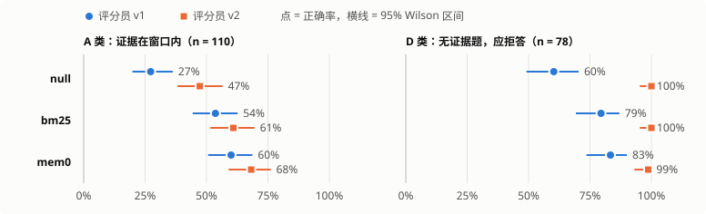
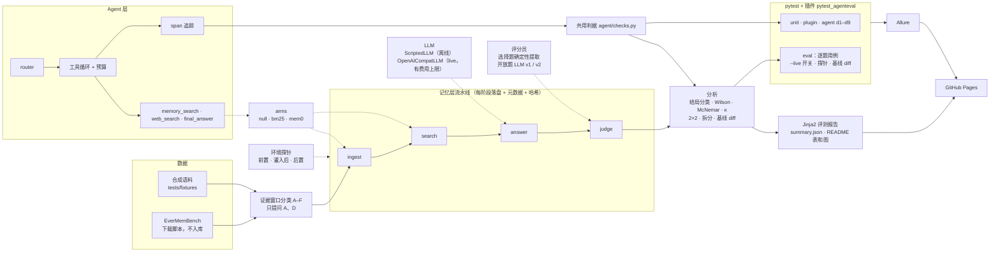

# agent-memory-eval

[](https://github.com/JerryZwr/agent-memory-eval/actions/workflows/ci.yml)
[](https://github.com/JerryZwr/agent-memory-eval/actions/workflows/pages.yml)

[](LICENSE)

**评测 AI 记忆系统和工具调用 Agent 的开源框架。重点不是谁的分数高，而是这个分数能不能信。**

*An evaluation framework for AI memory systems and tool-calling agents. The point is not who scores highest, but whether a score can be trusted. It does this with a no-memory control arm, evidence-window question selection, outcome classes that keep infrastructure failures out of accuracy, two judge prompts reported side by side, and exact paired tests. It also includes per-question baseline diffs, environment probes, and a deliberately tiny agent tested on nine behavioural dimensions. Everything runs offline in CI; the paid live run (EverMemBench, DeepSeek, local mem0) cost ¥5.61.*

**在线报告：**
- [真实运行报告 live-v1](https://jerryzwr.github.io/agent-memory-eval/live/live-v1/)：EverMemBench + DeepSeek + 本地 mem0。
- [离线评测报告](https://jerryzwr.github.io/agent-memory-eval/report/)：合成语料，CI 每次推送后生成。
- [Allure 测试报告](https://jerryzwr.github.io/agent-memory-eval/allure/)。

## 结果：真实运行 live-v1

EverMemBench 004 批前 90 天的语料，按证据窗口只提问能回答的 A 类题，以及无证据的 D 类题。对比三个 arm：
- null：什么都不存的对照组；
- bm25：本地关键词检索；
- mem0：本地开源版。

<!-- headline:start -->
<!-- 由 `agentmemeval readme` 从 `results/live-v1/summary.json` 生成，不要手改 -->



**答案正确率**（答对 / 已交付，95% Wilson 区间）。语料 `emb-004@a1607d39c0:2025-01-09..2025-05-14`，答题 `deepseek-flash+thinking=off`，评分员 `deepseek-v4-pro+thinking=off`；A 类 110 题，D 类 78 题。

| arm | A 类 · 评分员 v1 | A 类 · 评分员 v2 | D 类 · 评分员 v1 | D 类 · 评分员 v2 |
|---|---|---|---|---|
| null（对照组） | 30/110 = 27% [20%, 36%] | 52/110 = 47% [38%, 57%] | 47/78 = 60% [49%, 70%] | 78/78 = 100% [95%, 100%] |
| bm25 | 59/110 = 54% [44%, 63%] | 67/110 = 61% [52%, 70%] | 62/78 = 79% [69%, 87%] | 78/78 = 100% [95%, 100%] |
| mem0 | 66/110 = 60% [51%, 69%] | 75/110 = 68% [59%, 76%] | 65/78 = 83% [74%, 90%] | 77/78 = 99% [93%, 100%] |

**配对比较**（A 类，McNemar 精确检验；单元格 = 只有前者答对的题数 / 只有后者答对的题数，p 值）

| 比较 | 评分员 v1 | 评分员 v2 |
|---|---|---|
| bm25 vs null | 35 / 6，p < 0.001 | 29 / 14，p = 0.032 |
| mem0 vs null | 38 / 2，p < 0.001 | 32 / 9，p < 0.001 |
| mem0 vs bm25 | 15 / 8，p = 0.210 | 16 / 8，p = 0.152 |
<!-- headline:end -->

**读法：**
- **有检索比没检索答得好，这一点不依赖评分员口径。** A 类上，bm25 和 mem0 在两套口径下都显著高于 null。见 [F1](docs/findings.md#f1)。
- **mem0 与 bm25 之间未观察到显著差异。** 点估计 mem0 高 6–7 个百分点，但配对检验不显著，所以不说"更好"。见 [F2](docs/findings.md#f2)。
- **D 类（应拒答）的结论随评分员口径翻转。** v1 下记忆系统"显著更不容易幻觉"，v2 下差异消失。差异来自评分员，而不是被测系统；两个口径还各自违反自己的规则，方向相反。见 [F3](docs/findings.md#f3)、[F4](docs/findings.md#f4)。
- **查询形态：** 把选项拼进查询提高了证据命中率，截短的查询明显变差。见 [F5](docs/findings.md#f5)。
- **Agent 层：** 真实模型暴露了两个离线脚本没暴露的缺陷：路由时直接答题，以及不停检索、从不作答。提示词 v2 修复后，配对检验仍不显著，因为不一致的配对只有 3 个。见 [F6](docs/findings.md#f6)。
- **逐题 diff 能看到总分看不到的东西。** top_k 从 5 改到 10 后，D 类总分不变，但有 5 题变对、5 题变错，互相抵消。见 [F8](docs/findings.md#f8)。
- **费用：** 1576 次付费调用，¥5.61，上限是 4000 次 / ¥30。见 [F7](docs/findings.md#f7)。
- **局限：** 评分员**没有经过人工校准**，所以以上都是"某个评分员口径下"的正确率。见[局限](docs/findings.md#limits)。

上面的表和图由 `agentmemeval readme` 从 [`results/live-v1/summary.json`](results/live-v1/summary.json) 生成，没有手抄。手改一个数字，CI 就会失败（[`test_headline.py`](tests/unit/test_headline.py)）。

## 快速开始

只需要 [uv](https://docs.astral.sh/uv/getting-started/installation/)。默认的一切都离线运行，不需要任何 API key。

```powershell
# 安装 uv（已安装可跳过）
#   Windows:     powershell -ExecutionPolicy ByPass -c "irm https://astral.sh/uv/install.ps1 | iex"
#   macOS/Linux: curl -LsSf https://astral.sh/uv/install.sh | sh

git clone https://github.com/JerryZwr/agent-memory-eval.git
cd agent-memory-eval
uv sync                            # 首次会下载 Python 3.11+ 和依赖
uv run agentmemeval demo --open    # 离线 demo，1 秒左右跑完，并在浏览器中打开报告
```

**demo 做了什么：**
- 用 [`tests/fixtures/`](tests/fixtures/) 里自己编写的合成语料（3 天、2 个群、42 条消息、16 道题），跑 null 和 bm25 两个 arm，经过 ingest → search → answer → judge 四个阶段。
- 再用 6 种脚本化策略跑一遍 Agent 评测。
- 结果和 `report.html` 写在 `runs/demo-<时间>/` 下。

**更多命令：**

```powershell
uv run pytest                      # 框架自测 + Agent 层 9 个维度，全部离线（live 适配器的测试需 uv sync --extra live，否则注明原因跳过）
uv run pytest --alluredir=reports/allure-results   # 同上，并输出 Allure 结果
uv run agentmemeval agent-eval     # Agent 批量评测：交付率、路由混淆矩阵、耗时拆解
uv run pytest tests/eval           # 记忆层逐题评测（测量用，答错的题会失败）
uv run agentmemeval --help         # 全部子命令
```

## 架构



| 目录 | 内容 |
|---|---|
| [`src/agentmemeval/`](src/agentmemeval/) | `data` 数据与加载 · `arms` 被测记忆系统 · `llm` 模型与费用账本 · `pipeline` 四阶段 · `judge` 评分员 · `analysis` 统计与归因 · `agent` 极简 Agent · `tracing` 追踪 · `probes` 环境探针 · `report` 报告 |
| [`src/pytest_agenteval/`](src/pytest_agenteval/) | pytest 插件：`--live` 开关、前置和后置探针、逐题基线 diff、Allure 附件 |
| [`tests/`](tests/) | `unit` 组件 · `plugin` 插件自测（pytester） · `agent` 9 个维度 · `eval` 逐题评测 · `fixtures` 合成语料 |
| [`docs/`](docs/) | [方法定义](docs/METHODOLOGY.md) · [决策记录](docs/decisions.md) · [发现与常见错误](docs/findings.md) |
| [`results/`](results/) · [`baselines/`](baselines/) | 公开的真实运行结果包（不含数据集原文）· 冻结的基线 |

## 这个项目展示的测试能力

| 能力 | 在哪里 |
|---|---|
| 对照组与配对检验：不和 null 比、不做配对检验，就不说"更好" | [METHODOLOGY 1.1 / 1.7](docs/METHODOLOGY.md) · [`analysis/compare.py`](src/agentmemeval/analysis/compare.py) |
| 区分"没修好 / 没测到 / 环境坏了"，环境故障不算答错 | [`analysis/outcome.py`](src/agentmemeval/analysis/outcome.py) · [`tests/agent/test_d5_fault_injection.py`](tests/agent/test_d5_fault_injection.py) |
| 评分员可信性：两套口径并行、规则一致性检查、调用失败不等于判错 | [F3](docs/findings.md#f3) · [F4](docs/findings.md#f4) · [`judge/`](src/agentmemeval/judge/) |
| 可追溯：每个结果文件带语料标识、配置哈希、评分员版本、上游哈希；元数据不同的结果拒绝比较 | [`pipeline/records.py`](src/agentmemeval/pipeline/records.py) |
| 回归：冻结基线、逐题 diff（fixed / regressed / unchanged / not_measured） | [`analysis/baseline.py`](src/agentmemeval/analysis/baseline.py) · [F8](docs/findings.md#f8) |
| 环境探针：可写检查、上游红则下游记"未运行"、后置探针红则整轮不计 | [`probes/`](src/agentmemeval/probes/) |
| Agent 层 9 个维度：交付、收敛、路由、回退、故障注入、轨迹、反幻觉、trace 完整性、耗时拆解 | [`tests/agent/`](tests/agent/) |
| 先测试你的测试：每种缺陷策略都必须被某个检查抓住；坏 trace 必须被报出来 | [`test_policy_coverage.py`](tests/agent/test_policy_coverage.py) · [`test_d8_trace_integrity.py`](tests/agent/test_d8_trace_integrity.py) |
| 费用控制：调用次数和金额硬上限，超出就报错退出；结果缓存 | [`llm/usage.py`](src/agentmemeval/llm/usage.py) |

16 条"评测 AI 记忆与 Agent 时容易犯的错"，每条都配了本仓库里的反例和测试，见 [docs/findings.md](docs/findings.md)。

## 真实运行（可选，有费用）

需要 DeepSeek API key（写在 `.env`，模板见 [`.env.example`](.env.example)）。mem0 arm 还需要本地 [Ollama](https://ollama.com/) 和 `nomic-embed-text` 向量模型。调用次数和金额都有硬上限，超出就报错退出。

```powershell
uv sync --extra live --extra data
uv run python scripts/download_data.py                    # 数据集下载到 data/raw/（不入库）
ollama pull nomic-embed-text                              # 仅 mem0 需要
uv run agentmemeval live-init --out runs/my-session       # 只写配置，不调用；默认上限 4000 次 / ¥30
uv run agentmemeval run --run-dir runs/my-session/bm25    # 每个 arm 跑一次
uv run agentmemeval rejudge --from runs/my-session/bm25 --to runs/my-session/v2/bm25 --judge-version v2
uv run agentmemeval report --run runs/my-session
uv run agentmemeval publish --session runs/my-session --out results/my-session   # 可提交的公开结果包
```

数据集许可证与版本固定，见 [docs/decisions.md](docs/decisions.md) D-002。

## License

代码以 [MIT](LICENSE) 许可发布。EverMemBench 数据集不随本仓库分发，其许可见 [docs/decisions.md](docs/decisions.md)。
